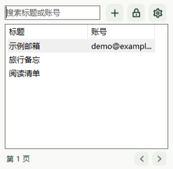
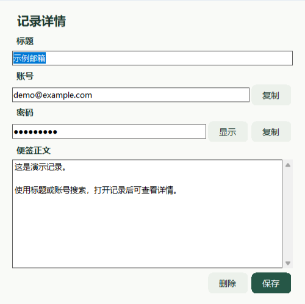

# 密笺

密笺是一款 Windows x64 本地加密便签。可以在同一个资料库里保存网站账号、密码和多行便签，通过标题或账号快速查找。资料库保存在本机，日常使用无需联网。

## 界面截图

截图使用虚构的演示记录。

| 资料库列表 | 记录详情 |
| --- | --- |
|  |  |

## 快速开始

1. 将 `密笺.exe` 和 `sqlite3mc.dll` 放在同一目录，双击 `密笺.exe`。
2. 首次使用时，输入并确认主密码，然后点击「创建资料库」。主密码可以很短，需至少输入一个字符。
3. 点击「新建」，填写标题和所需内容，然后点击「保存」。账号和密码都可留空，正文支持多行。
4. 资料库锁定后，使用当前主密码解锁。

**请妥善保管主密码。忘记后无法通过密笺找回或重置。更改主密码前保存的备份仍使用旧密码。**

## 日常使用

- **查找记录**　在搜索框输入标题或账号的一部分。列表按最近修改时间排序，每页最多显示 8 条。用右下角的左右箭头翻页，翻页时窗口高度保持固定。
- **复制账号和密码**　右键一条记录，选择「复制账号」或「复制密码」。详情窗口也有对应的复制按钮。若剪贴板仍保留这次复制的内容，密笺会在 30 秒后清除它。
- **查看和编辑**　双击记录打开详情。密码默认遮盖，可点「显示」。关闭有未保存内容的详情时，可以选择保存、放弃或取消。
- **隐藏和退出**　点击主窗口右上角的 × 将密笺隐藏到通知区域，资料库保持解锁。双击托盘里的盾牌恢复窗口。需要完全退出时，右键盾牌，选择「退出密笺」。
- **再次打开**　再次双击程序会恢复同一资料库的窗口。已锁定时会显示该资料库的解锁窗口。
- **锁定资料库**　主窗口和托盘菜单均可锁定。锁定后密笺留在托盘，从托盘重新打开时需输入主密码。
- **更改主密码**　在主窗口打开「设置 → 更改主密码」，输入当前主密码，然后输入并确认新密码。
- **开机自启动**　在「设置」中勾选「开机自启动」。下次登录当前 Windows 账户时，密笺以锁定状态在通知区域启动。

| 快捷键 | 操作 |
| --- | --- |
| `Ctrl + N` | 新建记录 |
| `Ctrl + F` | 定位到搜索框 |
| `Ctrl + S` | 保存当前记录 |
| `Ctrl + L` | 锁定资料库 |

## 资料库与备份

默认资料库文件位于：

```text
%LOCALAPPDATA%\QuickNoteVault\vault.qnv
```

按 `Win + R`，输入 `%LOCALAPPDATA%\QuickNoteVault` 并回车，即可打开文件所在目录。

备份时，先完全退出密笺，再将 `vault.qnv` 复制到备份目录。要查看或验证备份，可以将备份文件的副本拖到 `密笺.exe` 图标上，或在程序所在目录运行：

```powershell
& '.\密笺.exe' 'D:\Backups\vault-copy.qnv'
```

启动参数也可用于指定其他资料库。指定路径已有文件时，程序会提示输入该文件的主密码。指定路径尚无文件时，程序会进入创建流程。

## 清空与卸载

先从托盘菜单退出密笺，再双击同目录的 `维护密笺.cmd`。

- **清空默认资料库**　删除默认资料库及其 SQLite 辅助文件，程序和自启动设置保留。
- **卸载并清空默认资料库**　另外删除同目录的 `密笺.exe`、`sqlite3mc.dll`，并移除指向此程序的当前用户自启动条目。

选择操作后先输入 `Y`，再按提示输入 `CLEAR` 或 `UNINSTALL` 才会执行。自定义路径的资料库、备份和源码均保留。

## 存储与性能

- **整库加密**：SQLite3 Multiple Ciphers 使用 ChaCha20-Poly1305 加密资料库。主密码通过 600,000 轮 PBKDF2-HMAC-SHA256 派生密钥。
- **分页读取**：列表和搜索只读取标题、账号等摘要字段。打开详情或复制密码时按需读取完整记录。
- **事务与并发检查**：每条记录的保存通过事务提交。更新和删除会检查记录版本，避免覆盖其他窗口已提交的修改。

## 构建与测试

需要 Windows x64、.NET Framework 4.8 和同目录下的 `sqlite3mc.dll`。在项目根目录打开 PowerShell，运行：

```powershell
.\build.ps1
```

脚本使用系统的 C# 编译器生成 `密笺.exe`，无需还原 NuGet 包。

```powershell
.\tests\run.ps1
.\tests\run.ps1 -Gui
```

第一条命令使用临时资料库验证持久化、换密、并发冲突和分页，并测量 10,000 条记录下的单条提交与搜索耗时。第二条命令需要先构建程序，在 Windows 桌面上验证创建资料库、新增记录、搜索、复制、详情、托盘恢复和换密后重新解锁。

## 项目结构

| 文件 | 用途 |
| --- | --- |
| [Program.cs](Program.cs) | 程序入口、托盘，以及创建、解锁和更改主密码 |
| [MainForm.cs](MainForm.cs) | 紧凑列表、搜索、复制和详情窗口 |
| [UiStyle.cs](UiStyle.cs) | 应用图标、圆角按钮和过渡 |
| [Store.cs](Store.cs) | 加密存储、分页查询和并发检查 |
| [build.ps1](build.ps1) | Windows x64 构建脚本 |
| [tests](tests/) | 存储检查、性能测试和窗口回归测试 |

## 第三方组件

随附的 `sqlite3mc.dll` 来自 SQLite3 Multiple Ciphers 2.7.1 Windows x64 发行包。[上游发行页](https://github.com/utelle/SQLite3MultipleCiphers/releases/tag/v2.7.1) · [MIT 许可证](licenses/SQLite3MultipleCiphers-LICENSE)

DLL 的 SHA-256 为 `dc4e169632eec6c335214e3cc425ca9f5d57248235380622a4b4dc042e181b74`。
